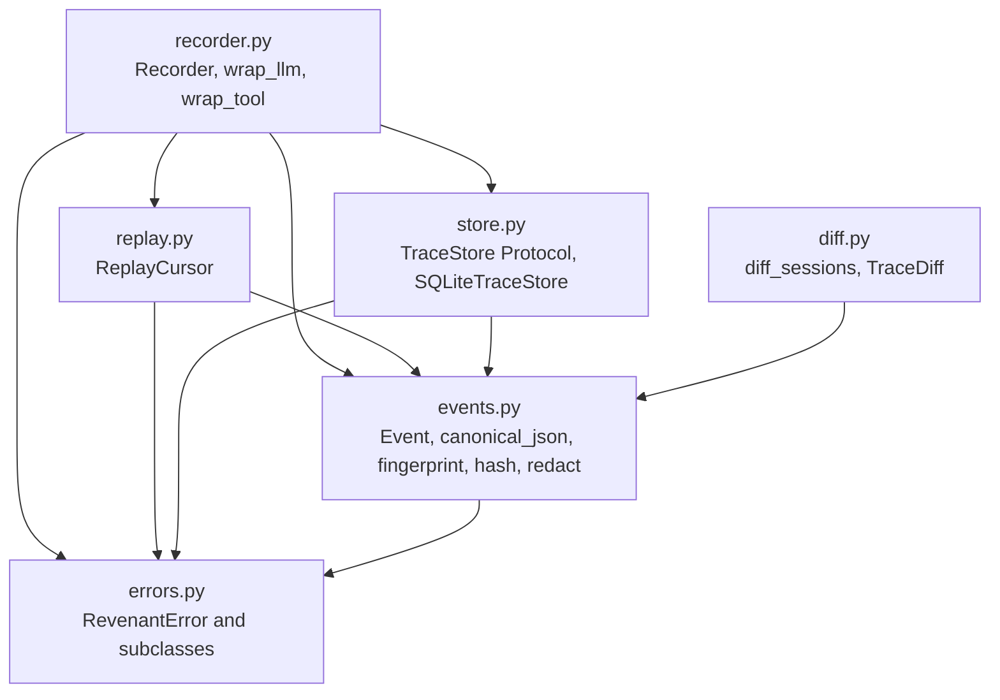
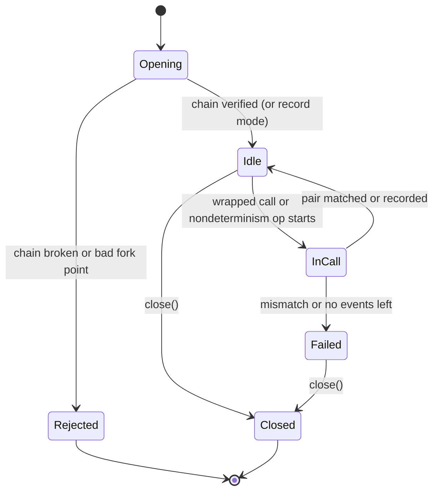

# Design Document

## Overview

Revenant core records agent sessions as hash-chained events in an append-only SQLite store and replays them strictly from the recording. It implements `requirements.md`. The package is `revenant`, under `revenant-core/src/revenant/`. No code is written yet; this document fixes the design.

Pending decisions A and B (see Open Decisions) affect `parent_step` and exception replay. This document uses my proposals for them.

## Architecture

### 1. Component diagram

Arrows mean "imports". Every arrow points toward `errors.py`, so there are no cycles.



| Module | Responsibility | Imports |
|---|---|---|
| `errors.py` | Exceptions and `UnconsumedEventsWarning` | nothing |
| `events.py` | `Event` model, `EventType`, `GENESIS_HASH`, `canonical_json`, `request_fingerprint`, `compute_hash`, `default_redactor` | `errors` |
| `store.py` | `TraceStore` Protocol, `SQLiteTraceStore`. The only module that imports `sqlite3`. | `events`, `errors` |
| `replay.py` | `ReplayCursor` over a `list[Event]`. No reference to any real function, no store access. | `events`, `errors` |
| `diff.py` | Pure comparison of two event sequences | `events` |
| `recorder.py` | Modes, wrappers, nondeterminism capture, redaction, concurrency guard, `close()` | all of the above |

Runtime flow. Record: `Recorder -> real fn -> Recorder -> store.append_event`. Replay: `store.load_session -> ReplayCursor -> Recorder -> caller`. The real function is not reachable from the replay path. Fork: replay path for the prefix, then the record path.

## Data Models

### 2. Event schema

Pydantic v2 model, `frozen=True`, `extra="forbid"`.

| Field | Type | Meaning |
|---|---|---|
| `event_id` | `str` | UUID4 hex, assigned when the event is built. |
| `session_id` | `str` | Owning session. |
| `step` | `int` | 0-based, +1 per event, no gaps. |
| `type` | `EventType` | One of the 7 types below. |
| `payload` | `dict[str, JSONValue]` | Redacted, canonically serializable. |
| `timestamp` | `str` | UTC ISO-8601 from an injectable clock. |
| `parent_step` | `int \| None` | On `tool_result` and `error`: step of the call event they answer. `null` otherwise. (Decision A.) |
| `prev_hash` | `str` | `GENESIS_HASH` at step 0, else the previous event's `hash`. |
| `hash` | `str` | See section 6. |

`JSONValue = None | bool | int | float | str | list[JSONValue] | dict[str, JSONValue]`. Tuples, sets, bytes, datetimes, NaN/Infinity, non-string dict keys and arbitrary objects are not JSON values and raise `PayloadSerializationError`. Tuples are rejected rather than turned into lists, because that conversion would be lossy.

Examples (hashes shortened to `...`; real values are 64 hex chars). One per event type:

```json
{"event_id":"e0","session_id":"s1","step":0,"type":"session_start",
 "payload":{"metadata":{"app":"demo"}},"timestamp":"2025-01-01T00:00:00+00:00",
 "parent_step":null,"prev_hash":"0000...0000","hash":"a1..."}
```
```json
{"event_id":"e1","session_id":"s1","step":1,"type":"llm_call",
 "payload":{"name":"llm","args":{"prompt":"find cats"},"fingerprint":"9f..."},
 "timestamp":"2025-01-01T00:00:01+00:00","parent_step":null,"prev_hash":"a1...","hash":"b2..."}
```
```json
{"event_id":"e2","session_id":"s1","step":2,"type":"tool_result",
 "payload":{"name":"llm","result":"call search('cats')"},
 "timestamp":"2025-01-01T00:00:01+00:00","parent_step":1,"prev_hash":"b2...","hash":"c3..."}
```
```json
{"event_id":"e3","session_id":"s1","step":3,"type":"tool_call",
 "payload":{"name":"search","args":{"query":"cats","api_key":"[REDACTED]"},"fingerprint":"4d..."},
 "timestamp":"2025-01-01T00:00:02+00:00","parent_step":null,"prev_hash":"c3...","hash":"d4..."}
```
```json
{"event_id":"e6","session_id":"s1","step":6,"type":"error",
 "payload":{"name":"fetch","exc_type":"builtins.TimeoutError","message":"timed out","args":["timed out"]},
 "timestamp":"2025-01-01T00:00:03+00:00","parent_step":5,"prev_hash":"...","hash":"..."}
```
```json
{"event_id":"e7","session_id":"s1","step":7,"type":"nondeterminism",
 "payload":{"kind":"uuid4","value":"3f2b8c1e-9a4d-4e7b-8a21-5c6d7e8f9012"},
 "timestamp":"2025-01-01T00:00:03+00:00","parent_step":null,"prev_hash":"...","hash":"..."}
```
```json
{"event_id":"e8","session_id":"s1","step":8,"type":"final_answer",
 "payload":{"value":"done"},"timestamp":"2025-01-01T00:00:04+00:00",
 "parent_step":null,"prev_hash":"...","hash":"..."}
```

`nondeterminism.kind` is `now` (value: ISO string), `uuid4` (value: string) or `random` (value: float). Floats round-trip exactly because `json` writes the shortest repr.

`llm_call` and `tool_call` share the `{name, args, fingerprint}` payload and differ only in `type`. Both are answered by a `tool_result` (for an LLM call the "result" is the response) or by an `error`.
### 3. Wrapped-call event pattern

One successful wrapped call (`wrap_llm` or `wrap_tool`) writes exactly two events at consecutive steps:

| Step | Event | Payload | `parent_step` |
|---|---|---|---|
| `n` | `llm_call` or `tool_call` | `{name, args, fingerprint}` | `null` |
| `n+1` | `tool_result` | `{name, result}` | `n` |

If the real function raises, the second event is an `error` instead of `tool_result`, with the same `parent_step = n`. The call event is written before the real function runs, so a crash mid-call leaves a call with no answer. Replay treats that as `ReplayExhaustedError` when it asks for the answer.

`recorder.now()`, `uuid4()`, `random()` write one `nondeterminism` event. `recorder.final_answer(value)` writes one `final_answer` event. None of these may run while a wrapped call is in progress (section 8), so the pair `n, n+1` is always adjacent.

Replay consumes the pair as one unit. `ReplayCursor.take_call(type, name, fingerprint)` checks the event at the cursor and advances by one. `ReplayCursor.take_answer(call_step)` then reads the next event, which must be `tool_result` or `error` with `parent_step == call_step`, and advances by one. The recorder returns the result or raises the recorded exception.

**Worked example: a 3-call session** (`llm`, `search`, `fetch`, then a final answer):

| Step | Type | Name | `parent_step` | Note |
|---|---|---|---|---|
| 0 | `session_start` | | null | Written by the recorder right after `create_session` (the store writes no event) |
| 1 | `llm_call` | `llm` | null | Call 1 |
| 2 | `tool_result` | `llm` | 1 | Answer to step 1 |
| 3 | `tool_call` | `search` | null | Call 2 |
| 4 | `tool_result` | `search` | 3 | Answer to step 3 |
| 5 | `tool_call` | `fetch` | null | Call 3 |
| 6 | `tool_result` | `fetch` | 5 | Answer to step 5 (an `error` if `fetch` raised) |
| 7 | `final_answer` | | null | |

Without interleaved `nondeterminism` events, call `k` (1-based) starts at step `1 + 2*(k-1)`. Replay does `take_call` at step 1, `take_answer` at step 2, and so on. After the 3 calls the cursor is at step 7. The `final_answer` event stays unconsumed until the driver asks for it, and `close()` warns with count 1 if it never does.

### 4. Replay state machine

States of a `Recorder`:



| From | Trigger | Condition | Result | Error |
|---|---|---|---|---|
| Opening | replay or fork constructed | session id unknown | no recorder | `SessionNotFoundError` |
| Opening | replay or fork constructed | `verify_chain` is false | no recorder | `ChainIntegrityError` |
| Opening | fork constructed | `at_step` out of range or not a call event | no recorder | `InvalidForkPointError` |
| InCall | another call or op starts | a call is already active | first call unaffected | `ConcurrentCallError` |
| InCall | `take_call` | no events left | Failed | `ReplayExhaustedError` |
| InCall | `take_call` | type, `name` or `fingerprint` differs | Failed | `DivergenceError(step, expected, actual, reason)` |
| InCall | `take_answer` | no next event | Failed | `ReplayExhaustedError` |
| InCall | `take_answer` | not `tool_result`/`error` with `parent_step == call_step` | Failed | `DivergenceError` |
| InCall | nondeterminism op | next event is not `nondeterminism` of the same `kind` | Failed | `DivergenceError` |
| InCall | recorded `error` | exception class cannot be rebuilt (decision B) | Failed | `DivergenceError` |
| InCall | recorded `error` | class rebuilt | Idle | the recorded exception is raised to the caller |
| Idle or Failed | `close()` | unconsumed events remain | Closed | `UnconsumedEventsWarning(count)` (warning only) |
| Failed | any call | | stays Failed | `RevenantError` |
| Closed | any call | | stays Closed | `RevenantError` |

`expected` and `actual` in `DivergenceError` are dicts: `{type, name, fingerprint}` for calls, `{type, kind}` for nondeterminism, `None` where no event exists. `step` is the step of the recorded event that failed to match. On an error the cursor does not advance. `close()` is idempotent, and `__exit__` calls it.

In record mode, a real function that raises is not a recorder failure. The `error` event is written, the original exception is re-raised, and the state returns to Idle.

### 5. Fork semantics

`Recorder.fork(store, parent_session_id, at_step, override=...)` has a prefix phase (steps below `at_step`) and a live phase (from `at_step`).

1. Load the parent, verify its chain, check that `at_step` is a call event. Failures: `SessionNotFoundError`, `ChainIntegrityError`, `InvalidForkPointError`.
2. Create the child session with `parent_session_id` and `parent_step = at_step` in the `sessions` table.
3. Copy parent events `0 .. at_step-1` into the child. A copy keeps `step`, `type`, `payload`, `timestamp`, `parent_step`. It gets a new `event_id`, the child `session_id`, and a recomputed `prev_hash` and `hash`, so the child chain verifies alone.
4. The cursor holds the copied prefix. The driver's first calls are replayed with strict matching and no real calls.
5. At `at_step` the call must have the same type, name and fingerprint as the parent's call event, otherwise `DivergenceError`. The call event is recorded in the child.
6. With an override, the real function is not called and the `tool_result` carries `result = override` and `overridden = true`. Without one, the real function runs and its result is recorded. `override` uses a sentinel default, so `None` is a valid override.
7. All later calls are live and recorded. Nothing is written to the parent.

**Worked example.** Parent `s1` is the session from section 3. Fork at `at_step = 3` with `override = {"hits": []}`.

| Child step | Type | Name | `parent_step` | Origin |
|---|---|---|---|---|
| 0 | `session_start` | | null | copied from parent step 0 |
| 1 | `llm_call` | `llm` | null | copied from parent step 1, replayed |
| 2 | `tool_result` | `llm` | 1 | copied from parent step 2, replayed |
| 3 | `tool_call` | `search` | null | recorded, matched against parent step 3 |
| 4 | `tool_result` | `search` | 3 | **override applies here**: `{"hits": []}`, `overridden: true`, real `search` not called |
| 5 | `tool_call` | `fetch` | null | live |
| 6 | `tool_result` | `fetch` | 5 | live, real `fetch` called once |
| 7 | `final_answer` | | null | live |

Child `sessions` row: `(session_id=c1, parent_session_id=s1, parent_step=3)`. Expected counters: `llm` 0, `search` 0, `fetch` 1. Since the prefix length equals `at_step`, child step numbers match the parent's up to the fork, and copied `parent_step` values stay valid. Parent events after `at_step` are not counted as unconsumed.

### 6. Hash chain

- `GENESIS_HASH = "0" * 64`, defined once in `events.py`, used as `prev_hash` at step 0.
- `hash = sha256((prev_hash + canonical_json(body)).encode("utf-8")).hexdigest()`.
- `body` is every event field except `hash`: `event_id`, `session_id`, `step`, `type`, `payload`, `timestamp`, `parent_step`, `prev_hash`.
- `canonical_json(obj)` = `json.dumps(obj, sort_keys=True, separators=(",", ":"), ensure_ascii=True, allow_nan=False)`, after a strict type check with no `default=` fallback. It is the only serializer used for hashing, fingerprints, storage and diffing.
- Excluded from hashing: the `hash` field itself and the `sessions` table (`created_at`, `parent_session_id`, `parent_step`). The fork link is therefore not tamper-evident (see risks).
- Empty sessions: `create_session` writes only the `sessions` row. A session with zero events is valid: `load_session` returns `[]`, `verify_chain` returns `True`, and `list_sessions` includes it. The first append must be step 0 with `prev_hash = GENESIS_HASH`, otherwise `ChainIntegrityError`.
- `verify_chain` reads rows in step order and checks that steps run 0, 1, 2, and so on, with no gaps, the first `prev_hash` is `GENESIS_HASH`, each `prev_hash` equals the previous `hash`, and each stored `hash` equals the recomputed one. Any failure returns `False`.

### 7. Redaction and fingerprint ordering

For every call the recorder runs these steps in this order, in record, replay and fork alike:

1. **Bind** the call arguments to a `dict[str, JSONValue]` with `inspect.signature(fn).bind(*args, **kwargs)` and `apply_defaults()`.
2. **Redact**: `args = redactor(args)`. If the hook raises, wrap the exception in `RevenantError` and stop. Nothing is stored.
3. **Serialize**: `canonical_json(args)`. A non-JSON value raises `PayloadSerializationError` and nothing is stored.
4. **Fingerprint**: `request_fingerprint(name, args)` on the redacted args.
5. **Persist** (record and the live phase of a fork) or **match** (replay and the fork prefix).

Results and error payloads go through redact, serialize, persist in the same order.

The order matters for three reasons:
- Redacting before persisting means secrets never reach the store, logs or hashes.
- Fingerprinting after redaction means the fingerprint never encodes a secret. A hash of a short secret could be brute-forced.
- Using the same order in replay means a rotated API key does not cause a false `DivergenceError`. A change in a non-secret argument still does.

The default redactor masks the keys `api_key`, `password`, `token`, `secret`, `authorization`, `cookie`, `bearer` and `private_key`. Matching is case-insensitive at any depth, including dicts inside lists, and each masked value becomes `"[REDACTED]"`. The redactor returns a new object and never mutates the caller's arguments.

### 8. Concurrency

v1 supports sequential calls only. A recorder holds `_active: str | None`, the name of the call or nondeterminism operation in progress.

- When a wrapper is entered: if `_active` is not `None`, raise `ConcurrentCallError(active=_active, attempted=name)` before touching the cursor, the store or the real function. Otherwise set `_active = name`.
- When the wrapper exits by any path (`try/finally`, including after `await`): set `_active = None`.

`asyncio.gather(tool_a(), tool_b())` on one recorder: the first coroutine sets `_active` and awaits, the second enters and raises `ConcurrentCallError`. The guard is a plain attribute, not a lock, because the goal is to detect overlap, not to serialize it. Threads use the same guard. It is not atomic across threads, and v1 documents threads as unsupported.

Nested calls, where a wrapped tool calls another wrapped function on the same recorder, also raise `ConcurrentCallError` in v1. A nested call would split the call/answer pair.

## Components and Interfaces

### 9. Public API signatures

Shared types and helpers (`events.py`):

```python
JSONValue = None | bool | int | float | str | list["JSONValue"] | dict[str, "JSONValue"]
Redactor = Callable[[JSONValue], JSONValue]

GENESIS_HASH: Final[str]
def canonical_json(obj: object) -> str: ...
def request_fingerprint(name: str, args: JSONValue) -> str: ...
def compute_hash(prev_hash: str, body: Mapping[str, JSONValue]) -> str: ...
def default_redactor(value: JSONValue) -> JSONValue: ...
```

Store (`store.py`):

```python
@dataclass(frozen=True)
class SessionInfo:
    session_id: str
    created_at: str
    parent_session_id: str | None
    parent_step: int | None

class TraceStore(Protocol):
    def create_session(self, session_id: str, *, parent_session_id: str | None = None,
                       parent_step: int | None = None) -> None: ...
    def append_event(self, event: Event) -> None: ...
    def load_session(self, session_id: str) -> list[Event]: ...
    def list_sessions(self) -> list[SessionInfo]: ...
    def verify_chain(self, session_id: str) -> bool: ...

class SQLiteTraceStore:  # structurally satisfies TraceStore
    def __init__(self, path: str | os.PathLike[str]) -> None: ...
    def close(self) -> None: ...
```

The fork link is read from `list_sessions()`, so the Protocol keeps exactly the five methods in R2.1.

Recorder (`recorder.py`):

```python
P = ParamSpec("P")
R = TypeVar("R")

class Recorder:
    session_id: str
    mode: Literal["record", "replay", "fork"]

    @classmethod
    def record(cls, store: TraceStore, *, session_id: str | None = None,
               metadata: Mapping[str, JSONValue] | None = None,
               redactor: Redactor = default_redactor) -> Recorder: ...
    @classmethod
    def replay(cls, store: TraceStore, session_id: str, *,
               redactor: Redactor = default_redactor) -> Recorder: ...
    @classmethod
    def fork(cls, store: TraceStore, parent_session_id: str, at_step: int, *,
             override: JSONValue | _Unset = UNSET, session_id: str | None = None,
             redactor: Redactor = default_redactor) -> Recorder: ...

    @overload
    def wrap_llm(self, fn: Callable[P, Coroutine[Any, Any, R]], *,
                 name: str | None = None) -> Callable[P, Coroutine[Any, Any, R]]: ...
    @overload
    def wrap_llm(self, fn: Callable[P, R], *, name: str | None = None) -> Callable[P, R]: ...
    # wrap_tool has the same two overloads

    def now(self) -> datetime: ...        # timezone-aware UTC
    def uuid4(self) -> uuid.UUID: ...
    def random(self) -> float: ...
    def final_answer(self, value: JSONValue) -> JSONValue: ...
    def close(self) -> None: ...
    def __enter__(self) -> Self: ...
    def __exit__(self, *exc_info: object) -> None: ...
```

Diff (`diff.py`):

```python
class DivergenceKind(StrEnum):
    DIFFERENT_TOOL = "different_tool"
    ARGS = "args"
    RESULT = "result"
    LENGTH = "length"

@dataclass(frozen=True)
class StepDiff:
    step: int
    kind: DivergenceKind
    a: JSONValue          # comparable view of the event in a, None if missing
    b: JSONValue

@dataclass(frozen=True)
class TraceDiff:
    first_divergent_step: int | None
    kind: DivergenceKind | None
    differing_steps: tuple[StepDiff, ...]
    len_a: int
    len_b: int

def diff_sessions(a: Sequence[Event], b: Sequence[Event]) -> TraceDiff: ...
```

`diff_sessions` compares step by step and ignores `event_id`, `session_id`, `timestamp`, `prev_hash` and `hash`. These are the rules for each step:
- Two call events with different `name`, or different `type` at the same step: `different_tool`.
- Two call events with the same `name` and different `args`: `args`.
- Answer, `nondeterminism`, `final_answer` or `session_start` events with different payloads: `result`.
- Steps that exist in only one session: `length`.

`kind` is the kind at `first_divergent_step`. Both sessions being equal gives `first_divergent_step=None`, `kind=None` and empty `differing_steps`.

Static types are kept: a wrapped `Callable[P, R]` stays `Callable[P, R]` for mypy. At runtime, replay returns the recorded JSON value (section 10). `now()`, `uuid4()` and `random()` are the exception: their return type is fixed, so they rebuild `datetime`, `UUID` and `float` from the recorded value.

## Error Handling

Every failure raises a typed `RevenantError` subclass, and nothing continues silently. The only non-exception signal is `UnconsumedEventsWarning(count)`, emitted by `close()`. Each append is one SQLite transaction, so after a failure the store holds either the whole event or none of it.

| Error | Raised when |
|---|---|
| `DivergenceError(step, expected, actual, reason)` | Replay or the fork prefix sees a different type, name, fingerprint, answer link or nondeterminism kind. Also raised when a recorded exception cannot be rebuilt (decision B). |
| `ReplayExhaustedError` | Replay needs an event and none remain. |
| `ChainIntegrityError` | `append_event` gets a wrong step or `prev_hash`, or replay/fork opens a session whose `verify_chain` is false. |
| `SessionNotFoundError` | Unknown session id. |
| `InvalidForkPointError` | `at_step` is out of range or not a call event. |
| `ConcurrentCallError` | A wrapped call or nondeterminism op starts while another is active. |
| `PayloadSerializationError` | A payload is not plain JSON. |

### 10. Risks and limitations

| Risk | Impact | Mitigation |
|---|---|---|
| Unwrapped nondeterminism (`time.time`, `uuid`, `random`, env vars, file reads, network called directly) | Replay can differ from the recording with no error, because the core never sees the call | Use `recorder.now/uuid4/random`. Anything else goes through `wrap_tool`. Documented in README. The core cannot detect sources it does not wrap. |
| Real side effects | Replay skips real functions, so writes and sends are not repeated. The live phase of a fork does run real functions from `at_step` on. | Replay never calls real functions (invariant tests, hook c). README warns about fork side effects. Idempotency is the caller's job. |
| Non-serializable results | A tool returning a dataclass, tuple, bytes, `datetime` or NaN cannot be recorded | `PayloadSerializationError` at record time; nothing lossy is stored. The caller converts to JSON inside the wrapped function. |
| Adapter coverage | Without framework adapters (out of scope), callers wrap functions by hand and can miss some | Small wrapping API. Adding or removing a wrapped call is caught as divergence. Adapters are a later layer. |
| Replay returns plain JSON | A function annotated `-> SomeModel` returns a `dict` on replay, which mypy cannot see | Stated in README and docstrings. Non-JSON values are rejected at record time, so callers must already return JSON. |
| Sequential calls only | `asyncio.gather` and threads over one recorder are unsupported | `ConcurrentCallError` on overlap. Threads are not detected reliably and are documented as unsupported. |
| Exception reconstruction | Exceptions with custom `__init__` may not rebuild from `args` | Fail closed with `DivergenceError` (decision B). |
| Secrets outside known keys | A secret inside free text or under an unlisted key is stored | Users pass a custom redactor. |
| Tail truncation | Deleting or truncating the last events of a session leaves a valid chain, so `verify_chain` is `True`. Moving the last event to another session (changing `session_id`) also leaves a valid chain in the original session. A hash chain cannot detect either. | Accepted for v1. Anchor the head hash somewhere the attacker cannot write, if this matters. Non-last rows are protected (changing `session_id` on a middle row fails `verify_chain`). Documented in the README. |
| Fork link not hashed | `sessions.parent_session_id/parent_step` can be edited without breaking a chain | Accepted for v1. The chain gives integrity of events, not authentication. |

## Testing Strategy

### 11. Traceability

Requirements to design sections:

| Requirement | Design sections |
|---|---|
| R1 Events (types, fields, steps, hash, genesis, canonical_json, fingerprint) | 2, 3, 6 |
| R2 Store (Protocol, WAL, one transaction, index, no UPDATE/DELETE, chain checks, not found) | 6, 9, Error Handling. Schema: tables `sessions` and `events` with `UNIQUE(session_id, step)`, index `idx_events_session_step`, `PRAGMA journal_mode=WAL`, `BEGIN IMMEDIATE` per append |
| R3 Recorder (modes, sync/async wrappers, errors, nondeterminism, redaction, fingerprints, sequential, serialization, close, plain JSON) | 3, 4, 7, 8, 9, 10 |
| R4 Replay (cursor, never real calls, divergence, exhausted, unconsumed warning, chain check at start) | 1, 3, 4 |
| R5 Fork (call-event `at_step`, new linked session, override, parent unchanged, invalid point, prefix copy) | 5, 9 |
| R6 Diff (data result, first step, kinds, ignored fields) | 9 |
| R7 Errors (base class, subclasses, DivergenceError fields, warning) | 4, Error Handling |

Required tests to requirements. Tests 1-10 are your list. Tests 11 and 12 are the redaction and v1-limit tests added in `requirements.md`; there they are numbered 10 and 11, and the Hypothesis test is 12.

| # | Test | Requirements checked |
|---|---|---|
| 1 | Record then replay: identical outputs, real-call counter 0 | R3.3, R4.1, R4.2 |
| 2 | Sync and async tools both replay | R3.2, R4.2 |
| 3 | Raised exception recorded and re-raised identically | R3.4, R3.5 |
| 4 | Changed args raise `DivergenceError` at the right step | R4.3, R7.3, R3.9 |
| 5 | Replay past the end raises `ReplayExhaustedError` | R4.4 |
| 6 | Editing a stored event makes `verify_chain` fail | R1.4, R1.5, R2.5, R2.7, R4.6 |
| 7 | Fork at step N: prefix replayed, rest live, child linked, override applied | R5.1-R5.6 |
| 8 | `diff_sessions` first divergent step per kind | R6.1-R6.4 |
| 9 | `now()`, `uuid4()`, `random()` identical across record and replay | R3.6 |
| 10 | Hypothesis: record/replay identity with zero real calls; `canonical_json` key-order stable; any single-field mutation breaks the chain | R1.4, R1.6, R1.8, R4.2 |
| 11 | Redaction of nested and mixed-case keys | R3.7, R3.8 |
| 12 | Concurrency, serialization, post-redaction fingerprints, `close()`/context manager, plain JSON | R3.9-R3.13, R4.5 |

Store tests also cover R2.1-R2.4, R2.6 and R2.8 directly. These include: WAL mode via `PRAGMA journal_mode`, the index via `sqlite_master`, a grep showing no UPDATE or DELETE in `store.py`, rejected out-of-order appends, and unknown sessions.

Test setup: a scripted fake LLM that returns canned responses by call index, 2-3 plain tool functions with call counters, and a driver fixture that is not an agent. Assertions use counters, never printed output.

## Open Decisions

- **A. `parent_step` on events.** This design sets it on `tool_result`/`error` to the step of the call they answer, and `null` elsewhere. The fork link is in the `sessions` table. The alternative is to use event-level `parent_step` only for fork lineage.
- **B. Exceptions that cannot be rebuilt on replay.** This design raises `DivergenceError`. The alternative is a new `ExceptionReconstructionError`.
